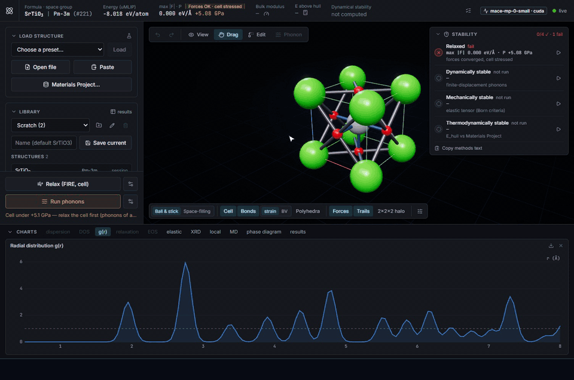
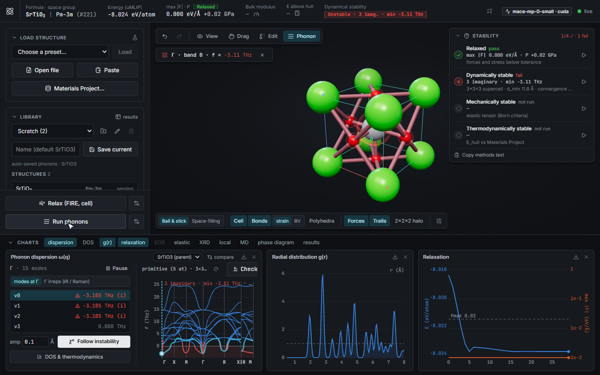
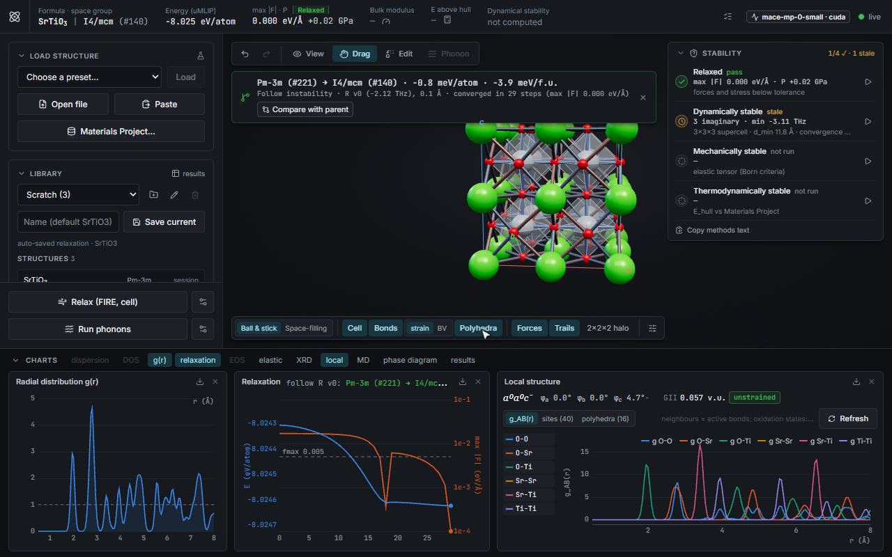

# LatticeFlow Studio

An interactive crystal and phonon studio for materials scientists. Load, generate or edit a crystal and watch the forces of a universal machine-learned interatomic potential (MACE) update live in 3D. Then answer the usual questions in seconds to minutes, on a laptop GPU or a CPU: is it relaxed, is it dynamically stable, is it mechanically stable, is it on the hull?



*Cubic SrTiO₃, start to finish: relax the cell, run phonons, pick the imaginary mode at R, and follow it into the tilted I4/mcm phase (Glazer a⁰a⁰c⁻). Recorded from the running app with MACE-MP-0 small by [`frontend/scripts/record-demo.mjs`](frontend/scripts/record-demo.mjs).*

Everything the UI does is also available from Python, so the studio can serve as a viewer and controller for notebook workflows and batch screens.

## Contents

- [What you can do](#what-you-can-do)
- [Quick start](#quick-start)
- [Python client](#python-client)
- [Workflows](#workflows)
- [Configuration](#configuration)
- [Tests](#tests)
- [Scientific scope and limits](#scientific-scope-and-limits)
- [Project layout](#project-layout)
- [Acknowledgements](#acknowledgements)
- [License](#license)

## What you can do

| Question | Tools |
|---|---|
| **What is it?** | Load presets (SrTiO₃, BaTiO₃, Si, Li₃PS₄), CIF / POSCAR / extxyz files or Materials Project ids. The structure panel shows the space group, Wyckoff sites, Z, density and crystal system. Simulated X-ray and neutron diffraction. Local analysis: coordination, polyhedra, bond-valence sums, global instability index, partial g(r), octahedral tilts in Glazer notation. Structure comparison and matching against Materials Project entries. |
| **Is it relaxed?** | Live forces, stress and pressure. Relaxation with FIRE, BFGS or LBFGS, optionally under symmetry, at external pressure and with a stress tolerance. The RELAXED badge accounts for stress. Refine-to-space-group snaps a structure to its symmetry. |
| **Is it dynamically stable?** | Finite-displacement phonons (phonopy) of the displayed cell, or of the primitive cell along the standard seekpath path. Γ irreps with IR/Raman activity. A supercell convergence check. Eigenmode animation at any q. DOS, projected DOS and harmonic F, S, C_v and ZPE. phonopy export. **Follow instability**: displace along an imaginary mode in its commensurate supercell, then relax into the distorted phase. |
| **Is it on the hull?** | E_hull against Materials Project reference phases that were *relaxed with the same potential*, so the energies are self-consistent (needs `MP_API_KEY`). The decomposition products and formation energy are reported. |
| **Is it mechanically stable?** | Bulk modulus from an equation-of-state fit. Full elastic tensor C_ij (relaxed-ion), Born stability, Voigt/Reuss/Hill K and G, Young's modulus, Poisson and Pugh ratios, anisotropy and Debye temperature. |
| **What happens at temperature?** | NVE / NVT / NPT molecular dynamics with live T, P, V and per-element MSD, and tracer diffusion coefficients. |
| **Defects and disorder** | Supercells, vacancies, substitutions (single, all symmetry-equivalent sites, or a fraction with a configuration search), interstitials. Neutral defect formation energies across the chemical-potential limits. Ordered approximants of disordered CIFs. |
| **How much do I trust the model?** | Model picker: MACE-MP-0 small / medium / large, MACE-MPA-0, MACE-OMAT-0, optional D3 dispersion. A model committee reports the spread of pressure, forces, volume and lattice across models. If MACE cannot load, a clear fallback watermark is shown. |
| **New candidates** | A symmetric-candidate generator (space-group-conditioned Wyckoff search, top-k ranked candidates). Prototype substitution into Materials Project structures, ranked by ionic-substitution probability and E_hull. |

Every committed change goes into the undo/redo history (50 entries), and the session is restored after a reconnect.

| Phonons of relaxed cubic SrTiO₃ | After following the R-point mode |
|---|---|
|  |  |

## Quick start

You need Python 3.11 and Node 22.12 or newer. A CUDA GPU is optional; small cells run fine on a CPU.

**1. Backend**, from `backend/`:

```bash
uv venv .venv --python 3.11            # or: python3.11 -m venv .venv
source .venv/bin/activate              # Windows: .venv\Scripts\activate
uv pip install -r requirements.txt     # or: pip install -r requirements.txt
uvicorn app.main:app --env-file ../.env   # http://127.0.0.1:8000
```

- **GPU.** Install the CUDA build of torch before the requirements, for example `uv pip install torch --index-url https://download.pytorch.org/whl/cu124`.
- **First start.** It downloads the MACE-MP-0 *small* checkpoint (about 40 MB) into `~/.cache/mace`. Every start then loads the model and runs a warm-up single point before accepting connections. Larger models download when you first pick them.
- **Environment file.** `--env-file ../.env` loads local settings from the repo-root `.env` (gitignored; copy [`.env.example`](.env.example)). The backend starts without the file.
- **Materials Project key.** Set `MP_API_KEY` in `.env` to enable the hull, Materials Project search and import, prototype search and defect chemical potentials. Without it those features report themselves unavailable and everything else works. Keys are free at [materialsproject.org](https://next-gen.materialsproject.org/api).
- **Fallback.** If the checkpoint can't be loaded (for example offline with no cache), the backend falls back to an analytic Lennard-Jones + Coulomb calculator and the UI shows a watermark. Fallback numbers are for testing only.

**2. Frontend**, from `frontend/`:

```bash
npm install
npm run dev          # http://localhost:5173 (proxies /api and /ws to the backend on :8000)
```

Open http://localhost:5173. To talk to a backend elsewhere, set `VITE_BACKEND_URL=http://host:8000` in `frontend/.env`.

**Docker.** `docker compose up --build`, then open http://localhost:5173. The compose file is an untested scaffold. It uses CPU torch by default; see the comments in [`docker-compose.yml`](docker-compose.yml) for GPU.

## Python client

```bash
pip install -e clients/python          # deps: websockets, httpx; ase / pymatgen optional for conversions
```

```python
from latticeflow_client import Studio

with Studio("http://localhost:8000") as studio:          # its own session (separate from the browser UI)
    studio.load(preset="srtio3")                          # or cif=..., atoms=<ase.Atoms>, structure=<pymatgen>, mp_id=...
    studio.relax(fmax=0.005, fix_symmetry=True)
    ph = studio.phonons(cell_mode="primitive", dos=True)
    studio.follow_instability(label="R")                  # softest mode at R
    print(studio.local_analysis()["octahedral_tilts"]["glazer"])   # a0a0c-
    atoms = studio.to_ase()
```

- Each method sends one command and blocks until its terminal message arrives.
- `on_frame` and `on_progress` callbacks stream intermediate frames and progress; `stop()` cancels.
- A server `ERROR` raises `StudioError(code, message)`; a cancelled stream raises `StreamStopped`.
- `AsyncStudio` offers the same API as coroutines.
- REST helpers: `hull()`, `diffraction()`, `compare()`, `mp_search()`, `mp_match()`, `export()` and more.

Batch screening from the command line: `latticeflow-screen compositions.csv --out results.csv --elastic [--hull]`.

Examples, including a Jupyter notebook, are in [`clients/python/examples`](clients/python/examples). Every command, event and REST endpoint is listed in [`docs/protocol.md`](docs/protocol.md).

## Workflows

Step-by-step recipes, for the UI and for Python, are in [`docs/workflows.md`](docs/workflows.md):

1. **Soft-mode transition.** Cubic SrTiO₃: relax, find the imaginary R-point mode, follow it into I4/mcm, then compare with the parent (group–subgroup relation, ΔE).
2. **Defect formation energy.** Relax the bulk, build a supercell, create a vacancy or substitution, relax at fixed cell, then compute E_f at each chemical-potential limit.
3. **Ionic diffusion.** Run NVT MD at several temperatures, take D(T) from the MSD, and fit an Arrhenius E_a.
4. **Model committee.** Measure the spread across MACE models before trusting a number.
5. **Screening.** Prototype search or the generator, then relax, phonons, hull and elastic tensor, written to a table.

## Configuration

All settings are optional; see [`.env.example`](.env.example).

| Variable | Default | Purpose |
|---|---|---|
| `LATTICEFLOW_DEVICE` | `auto` | `cuda`, `cuda:N` or `cpu` |
| `LATTICEFLOW_DTYPE` | `float64` | `float32` is faster but too noisy for finite-displacement phonons |
| `LATTICEFLOW_UMLIP` | `auto` | `mace` (fail if unavailable) or `fallback` (analytic calculator only) |
| `LATTICEFLOW_MACE_MODEL` | `small` | process default model: a `mace_mp` name or a local checkpoint path (sessions can switch with the model picker) |
| `LATTICEFLOW_MACE_DOWNLOAD_TIMEOUT` | `180` | seconds allowed for a first-time checkpoint download |
| `LATTICEFLOW_MACE_ALLOW_DOWNLOAD` | `1` | `0` = never touch the network (local cache only) |
| `MP_API_KEY` | – | Materials Project key: hull, MP search/import/match, prototype search, defect chemical potentials |
| `LATTICEFLOW_HULL_CACHE_DIR` | `~/.cache/latticeflow/hull` | cache of relaxed hull reference phases (per chemical system and model) |
| `LATTICEFLOW_DATA_DIR` | `~/.latticeflow` | project library and job queue (`library.db`, SQLite) |
| `LATTICEFLOW_CORS_ORIGINS` | Vite on :5173 | comma-separated allowed origins |
| `LATTICEFLOW_MAX_ATOMS` | `128` | atoms per structure (load, supercell, add atom, follow instability) |
| `LATTICEFLOW_PHONON_MAX_ATOMS` | `64` | atoms per cell for a phonon calculation |
| `VITE_BACKEND_URL` (frontend) | – (Vite proxy) | backend URL for the frontend |

Fixed limits: 600 atoms per phonon supercell, 64 atoms per generated candidate, elements up to Z = 89.

The backend has no authentication. It is meant to run on your own machine or a trusted network; don't expose it to the internet as is.

## Tests

```bash
# backend, from backend/ (with the venv active)
pytest -q                                # full suite; MACE tests skip if the checkpoint is unavailable
LATTICEFLOW_SKIP_MACE=1 pytest -q        # fallback calculator only (about 2 minutes, no GPU or download)

# frontend, from frontend/
npm test
npm run typecheck
npm run build

# Python client, from the repo root (starts an in-process backend with the fallback calculator)
pip install -e clients/python
pytest clients/python/tests -q
```

**Validation sweep.** With the backend running, `python clients/python/examples/validation.py` runs the main workflows on Si, SrTiO₃, BaTiO₃ and NaCl and prints about 60 checks of two kinds:

- *Consistency* checks must pass with any model: the bulk modulus from the equation of state matches the elastic tensor, C_ij has the crystal's symmetry, the phonon DOS integrates to 3N, a supercell has the same energy per atom, and file export and import round-trip. A failure here is a bug.
- *Reference* checks compare with experiment. With MACE-MP-0 small all consistency checks pass, and the reference checks that fall outside tolerance are the model softness described below (add `--model medium-mpa-0` to see the larger model).

## Scientific scope and limits

- **The force field is a screening-grade universal potential.** MACE-MP-0 *small*, the default, is systematically soft:
  - bulk and elastic moduli run low (Si C11 ≈ 96 GPa against ≈ 166 GPa experimentally);
  - phonon frequencies are underestimated (the Si optical mode is about 11.5 THz against about 15.5 THz);
  - barriers come out too low.

  The larger models are closer but still soft: MACE-MPA-0 medium gives K ≈ 86 GPa for Si (98 GPa experimentally) and an optical mode of 12.7 THz. Use them for quantitative work and check the committee spread. The potential gives no electronic properties: no band gaps, magnetism or charge states. Confirm anything important with DFT.
- **Phonons are harmonic,** computed by finite displacement in a finite supercell. There is no anharmonic renormalisation, so "unstable at 0 K" does not mean unstable at room temperature. Cubic SrTiO₃ and BaTiO₃ are the high-temperature phases.
- **No LO–TO splitting.** There is no non-analytical correction, so polar crystals show no LO–TO splitting at Γ. Check supercell convergence before trusting soft modes. Results for unrelaxed structures, such as the Li₃PS₄ preset as loaded, are not physically meaningful; relax first.
- **E_hull is self-consistent in the potential.** It is measured against Materials Project structures relaxed with the same potential, not against MP's DFT energies. Its accuracy is bounded by the model's formation-energy error, typically tens of meV/atom.
- **Defects are neutral only.** There are no charge states and no finite-size or image-charge corrections. With the default 128-atom cap, defect–image distances are often below 10 Å; the studio warns when they are.
- **MD diffusion coefficients are tracer D from the MSD.** Nernst–Einstein conductivities assume uncorrelated hops (Haven ratio 1). Short runs in small cells give noisy D, and Arrhenius extrapolation to room temperature amplifies errors.
- **The generator is not a learned model.** It is a seeded, budgeted search over symmetric Wyckoff arrangements of the target space group. The lowest-energy candidates under the force field are kept (top-k), and the run is animated as a flow onto the endpoint. High-symmetry targets come out clean (perovskite, diamond, rock salt). Low-symmetry targets with many free parameters give locally relaxed structures, not global minima. For plausible new compounds, prototype substitution is usually the better route.

## Project layout

```
backend/           FastAPI app: physics core (app/core), REST + WebSocket API (app/api), schemas, tests
frontend/          React + three.js (react-three-fiber) UI, vitest tests, dev scripts
clients/python/    latticeflow_client: sync and async Python client, screening CLI, examples
docs/protocol.md   every WebSocket command and event and every REST endpoint
docs/workflows.md  step-by-step scientific workflows
docs/design/       the original specification and review (historical)
```

The backend serves one `/ws/studio` WebSocket session per client, plus stateless `/api/*` REST endpoints.

## Acknowledgements

LatticeFlow Studio is a front end to other people's science. If you publish results obtained with it, please cite the underlying methods:

- [MACE](https://github.com/ACEsuit/mace) and the MACE-MP-0 foundation models (the interatomic potentials). The checkpoints are downloaded from the MACE project and carry their own licences; check them before commercial use.
- [phonopy](https://phonopy.github.io/phonopy/) (phonons), [SeeK-path](https://github.com/giovannipizzi/seekpath) (band paths) and [spglib](https://spglib.readthedocs.io/) (symmetry).
- [ASE](https://wiki.fysik.dtu.dk/ase/) (optimisers, MD) and [pymatgen](https://pymatgen.org/) (structure matching, diffraction, elasticity, bond valence).
- [The Materials Project](https://materialsproject.org/) (reference structures) and [PyXtal](https://github.com/MaterSim/PyXtal) (Wyckoff tables).
- [torch-dftd](https://github.com/pfnet-research/torch-dftd) (D3 dispersion).

## License

[MIT](LICENSE). The libraries and model checkpoints the studio uses have their own licences.
